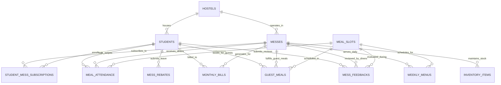

# Mess Management System Backend Database

A complete, production-grade SQL backend database architecture for an institutional **Mess Management System**, with an **Entity-Relationship (ER) Diagram**, **Relational Schema**, schema DDL, test fixtures, and business queries.

---

## 📁 Project Directory Structure

```text
d:\Prj\
├── schema.sql             # Complete DDL: 12 tables, indexes, check constraints, foreign keys & views
├── seed_data.sql          # Realistic test fixtures (hostels, messes, students, menus, logs, bills)
├── queries.sql            # 12 operational & analytical business queries
├── database_design.md     # Detailed ER diagram (Mermaid), relational schema, 3NF/BCNF analysis
├── setup_database.py      # Python script to build SQLite database & run checks
├── test_queries.py        # Automated test runner validating all 12 queries
├── mess_management.db     # Generated SQLite database file
└── README.md              # Project overview and quick start guide
```

---

## 🎯 Required Attributes Specification

The system includes the exact attributes requested, properly normalized across relational tables:

| Required Attribute | Database Column | Table | Data Type & Constraint | Notes |
| :--- | :--- | :--- | :--- | :--- |
| **Name** | `full_name` | `students` | `VARCHAR(100) NOT NULL` | Student's full legal name |
| **Registration number** | `registration_no` | `students` | `VARCHAR(20) NOT NULL UNIQUE` | Unique student institutional ID |
| **Room** | `room_no` | `students` | `VARCHAR(10) NOT NULL` | Room number |
| **Room Block/Hostel** | `hostel_id` | `students` (FK to `hostels`) | `INTEGER NOT NULL` | References hostel building and block code |
| **Veg / Non Veg Food** | `dietary_preference` | `students` | `VARCHAR(15) NOT NULL CHECK (...)` | `VEG`, `NON_VEG`, `JAIN`, `EGG_ONLY` |

---

## 🧩 Key System Entities & Additional Attributes

To support full mess operations, the following entities and relations are integrated:

1. **`students`**: Student registration, personal details, contact, room number, dietary preference (`VEG` / `NON_VEG`), year of study, emergency contact.
2. **`hostels`**: Hostel blocks, warden contact, gender allocation.
3. **`messes`**: Dining halls, caterer details, capacity, monthly base fee, rebate daily deduction rate.
4. **`student_mess_subscriptions`**: Student-to-mess mapping and membership period.
5. **`meal_slots`**: `BREAKFAST`, `LUNCH`, `SNACKS`, `DINNER`, start/end timings, and guest rates.
6. **`weekly_menus`**: Day-wise recurring food schedule with separate items for Veg and Non-Veg.
7. **`meal_attendance`**: Swipe/scan logs per meal slot with duplicate-prevention constraints.
8. **`mess_rebates`**: Student leave applications with start/end dates, approval workflow, and bill deduction tracking.
9. **`monthly_bills`**: Invoicing engine tracking base fee, rebate reductions, guest meal surcharges, payment status (`PAID`, `OVERDUE`, `UNPAID`).
10. **`guest_meals`**: Guest coupon booking and revenue tracking.
11. **`mess_feedbacks`**: Student ratings (1-5) and grievance management.
12. **`inventory_items`**: Kitchen ration and raw material stock levels with low-stock alerts.

---

## 📊 Entity-Relationship (ER) Diagram

See [database_design.md](database_design.md) for full diagram details:



---

## 🚀 How to Run and Test

### Option 1: Automated Python Runner (SQLite)
Run the automated initialization script:
```powershell
python setup_database.py
```
This builds `mess_management.db`, enforces foreign keys, loads seed data, and executes key queries.

To test all 12 operational queries:
```powershell
python test_queries.py
```

### Option 2: Direct SQL Client (PostgreSQL / MySQL / SQLite CLI)
Run standard SQL scripts directly:
```powershell
# For SQLite:
sqlite3 mess_management.db < schema.sql
sqlite3 mess_management.db < seed_data.sql

# For PostgreSQL:
psql -U username -d mess_db -f schema.sql
psql -U username -d mess_db -f seed_data.sql

# For MySQL:
mysql -u username -p mess_db < schema.sql
mysql -u username -p mess_db < seed_data.sql
```

---

## 🔍 Core Operations & Analytical Queries in `queries.sql`

1. **Student Lookup**: Query full profile by Registration Number (`registration_no`).
2. **Kitchen Daily Headcount Demand Forecast**: Aggregates Veg vs Non-Veg portions required for today's meals, automatically excluding students on approved mess leave/rebate.
3. **Active Student Leaves / Rebate Tracker**: Identifies students away from campus today.
4. **Monthly Bill & Rebate Computation**: Computes $\text{Net Bill} = \text{Base Fee} - (\text{Rebate Days} \times \text{Rebate Rate}) + \text{Guest Charges}$.
5. **Fee Defaulter Tracking**: Surfaces students with `OVERDUE` balances.
6. **Real-time Attendance Swipe Log**: Scanned dining timestamps and verification methods.
7. **Weekly Menu Display**: Menu items for specific days and meal categories.
8. **Hostel Dietary Distribution**: Veg vs Non-Veg counts per hostel block.
9. **Kitchen Low-Stock Inventory Alerts**: Notifies when items fall below reorder thresholds.
10. **Mess Rating & Grievance Dashboard**: Caterer performance and feedback analytics.
11. **Guest Meal Revenue**: Revenue generated from guest meal vouchers.
12. **Absenteeism / Meal Skip Detection**: Identifies students who did not attend meals.
