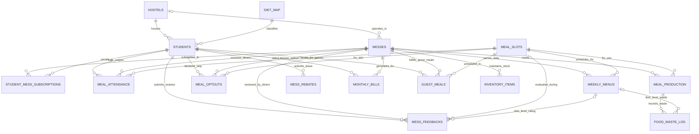

# Mess Management System Backend Database

SQL backend for an institutional **Mess Management System** (MySQL 8.0.16+): schema DDL, seed data, 19 business/analytical queries, Python setup and test runners, ER diagrams.

---

## 📁 Project Directory Structure

```text
d:\Prj\
├── schema.sql              # DDL: 16 tables, indexes, CHECK constraints, FKs, 5 views
├── seed_data.sql           # Test fixtures (dates relative to CURDATE() except Sept 2026 billing)
├── queries.sql             # 19 operational & analytical queries (+ session parameters)
├── db_config.py            # MySQL settings (env vars) + SQL splitting helpers
├── setup_database.py       # Builds mess_management DB, loads seed, prints verification tables
├── test_queries.py         # Runs every query in queries.sql, checks row-count expectations
├── requirements.txt        # mysql-connector-python>=8.0
├── database_design.md      # 16-table Mermaid ER, relational schema, normalization, constraints, views
├── er_diagram.html         # Interactive Mermaid ER viewer (pan/zoom)
├── CHEN_ER_DIAGRAM.md      # Chen-notation core model: catalog, cardinalities
├── generate_chen_svg.py    # Generates chen_er_diagram.svg
├── chen_er_diagram.svg     # Generated Chen diagram
├── chen_er_diagram.html    # Interactive Chen viewer (pan/zoom)
└── README.md
```

---

## 🎯 Required Attributes Specification

| Required Attribute | Database Column | Table | Type & Constraint | Notes |
| :--- | :--- | :--- | :--- | :--- |
| **Name** | `full_name` | `students` | `VARCHAR(100) NOT NULL` | Student's full name |
| **Registration number** | `registration_no` | `students` | `VARCHAR(20) NOT NULL UNIQUE` | Institutional ID |
| **Room** | `room_no` | `students` | `VARCHAR(10) NOT NULL` | Room number |
| **Hostel / block** | `hostel_id` | `students` (FK → `hostels`) | `INT NOT NULL` | Gives block code |
| **Veg / Non Veg Food** | `dietary_preference` | `students` (FK → `diet_map`) | `VARCHAR(15) NOT NULL` | `VEG`, `NON_VEG`, `JAIN`, `EGG_ONLY`; `diet_map` maps to kitchen group `VEG` / `NON_VEG` |

---

## 🧩 Tables (16) and Views (5)

| # | Table | Purpose |
| :-: | :--- | :--- |
| 1 | `hostels` | Hostel blocks, warden, gender allocation |
| 2 | `messes` | Dining halls, caterer, capacity, monthly fee, per-day rebate rate |
| 3 | `diet_map` | Single source: dietary preference → kitchen cooking group |
| 4 | `students` | Registration, room, diet, contact, department, year, account status |
| 5 | `meal_slots` | `BREAKFAST`, `LUNCH`, `SNACKS`, `DINNER`, timings, guest rate |
| 6 | `student_mess_subscriptions` | Student-to-mess plan; at most one `ACTIVE` per student |
| 7 | `weekly_menus` | Day-wise menu per mess, slot, diet category |
| 8 | `meal_optouts` | Student declares in advance a skipped meal, kitchen cooks less |
| 9 | `meal_production` | What kitchen cooked per mess / date / slot / diet line (kg, cost) |
| 10 | `food_waste_log` | Waste by stage and reason, optional dish-level link |
| 11 | `meal_attendance` | Swipe logs, duplicate-swipe prevention |
| 12 | `mess_rebates` | Leave applications, approval workflow |
| 13 | `monthly_bills` | Invoices; `net_payable` is a generated column |
| 14 | `guest_meals` | Guest meal bookings and revenue |
| 15 | `mess_feedbacks` | Ratings, grievances, dish-level `plate_left` feedback |
| 16 | `inventory_items` | Kitchen stock with reorder thresholds |

Views: `v_active_student_directory`, `v_student_billing_summary`, `v_mess_ratings_summary`, `v_waste_summary`, `v_eligible_diners`.

---

## 📊 Entity-Relationship (ER) Diagram

Full attributes: [database_design.md](database_design.md) and [er_diagram.html](er_diagram.html). Chen notation (core model): [CHEN_ER_DIAGRAM.md](CHEN_ER_DIAGRAM.md), [chen_er_diagram.html](chen_er_diagram.html).



---

## 🚀 How to Run and Test

Requires **MySQL 8.0.16+** (CHECK constraints enforced from this version; generated columns used).

### Option 1: MySQL Workbench
1. Open `schema.sql`, run whole script (Ctrl+Shift+Enter). **Drops and recreates** `mess_management`.
2. Run `seed_data.sql` the same way.
3. Open `queries.sql`. Run the `USE` and `SET` lines first (same session), then put cursor inside a query and press Ctrl+Enter.

### Option 2: Python runner
```powershell
pip install -r requirements.txt
$env:MYSQL_PASSWORD="your_password"
```
Optional env vars: `MYSQL_HOST` (default `127.0.0.1`), `MYSQL_PORT` (`3306`), `MYSQL_USER` (`root`).

```powershell
python setup_database.py            # asks you to type the DB name before wiping an existing database
python setup_database.py --force    # no prompt (CI / scripted use)
python test_queries.py              # runs all 19 queries from queries.sql
```
- `setup_database.py`: runs `schema.sql` + `seed_data.sql`, then prints verification tables (sample students, kitchen demand forecast, active leaves, Sept 2026 billing, low stock, waste summary).
- `test_queries.py`: each query needs a minimum row count on seed data (Q1-Q18). Q19 is an integrity audit: **any row is a failure**. Exits with code 1 on failure.

### Option 3: MySQL command line
```powershell
mysql -u username -p < schema.sql
mysql -u username -p < seed_data.sql
```

### Query parameters
`queries.sql` starts with session variables (override to inspect another day or cycle):

| Variable | Default | Used by |
| :--- | :--- | :--- |
| `@on_date` | `CURDATE()` | Q2, Q3, Q6, Q12 |
| `@slot_id`, `@mess_id` | 2 (lunch), 1 | Q2, Q12 |
| `@bill_month`, `@bill_year` | 9, 2026 | Q4 |
| `@target_date`, `@target_slot` | tomorrow, 2 | Q16 |
| `@default_kg_per_head` | 0.35 | Q16 fallback |

---

## 🔍 Queries in `queries.sql`

| # | Query |
| :-: | :--- |
| 1 | Student profile by registration number |
| 2 | Kitchen headcount forecast per mess and diet group (excl. approved leaves and opt-outs) |
| 3 | Students on approved rebate / leave on `@on_date` |
| 4 | Monthly bill statement for `@bill_month` / `@bill_year` |
| 5 | Fee defaulters: `OVERDUE`, or `UNPAID` past due date |
| 6 | Lunch attendance log on `@on_date` |
| 7 | Monday menu for mess 1 |
| 8 | Veg / Non-Veg / Jain / Egg-only distribution per hostel |
| 9 | Low-stock inventory alerts |
| 10 | Mess quality and hygiene ratings dashboard |
| 11 | Guest meals consumed and revenue |
| 12 | Absenteeism / meal-skip detection |
| 13 | Waste per meal per day (kg, %, INR) |
| 14 | Root cause of waste, by reason |
| 15 | Dish-level waste vs student rating |
| 16 | Production target: suggested kg to cook for `@target_date` / `@target_slot` (14-day history, falls back to all-mess average, then default) |
| 17 | Weekly waste trend per mess |
| 18 | Feedback action list: dishes left on the plate |
| 19 | Data-integrity audit (expect 0 rows) |

**Billing rule** (`monthly_bills`): `net_payable = base_fee − rebate_amount + guest_charges + fines_or_extras`, a stored generated column. `rebate_amount` is a snapshot of `rebate_days × mess per_day_rebate_rate` at billing time.
