# Mess Management System — Backend Database Architecture & Design

This document details the backend relational database design for an institutional **Mess Management System**, including the **Entity-Relationship (ER) Diagram**, **Relational Schema**, **Normalization Analysis (up to BCNF)**, and **Data Dictionary**.

---

## 1. System Overview & Core Requirements

The database manages university/hostel dining halls (messes) with high throughput and strict tracking. It satisfies all user requirements:

- **Student Attributes**:
  - **Name**: `full_name`
  - **Registration Number**: `registration_no` (Unique student identifier)
  - **Room Number**: `room_no` (Linked with hostel block code)
  - **Veg / Non-Veg Food Choice**: `dietary_preference` (`VEG`, `NON_VEG`, `JAIN`, `EGG_ONLY`)
  - **Additional Mess Attributes**:
    - Contact & Department details (`email`, `phone_number`, `department`, `year_of_study`)
    - Hostel residence details (`hostels`)
    - Dining hall allocations & subscriptions (`student_mess_subscriptions`)
    - Daily meal slots & timings (`meal_slots`: Breakfast, Lunch, Snacks, Dinner)
    - Weekly rotating food menus (`weekly_menus`)
    - Real-time meal swipe/attendance tracking (`meal_attendance`)
    - Mess leaves & fee rebates (`mess_rebates`)
    - Monthly billing, discounts & fine tracking (`monthly_bills`)
    - Guest meal vouchers (`guest_meals`)
    - Quality feedback & grievances (`mess_feedbacks`)
    - Kitchen ration/inventory stock alerts (`inventory_items`)

---

## 2. Entity-Relationship (ER) Diagram

Below is the complete ER diagram in Mermaid notation illustrating all entities, attributes, primary keys (`PK`), foreign keys (`FK`), and cardinalities.

```mermaid
erDiagram
    HOSTELS ||--o{ STUDENTS : houses
    HOSTELS ||--o{ MESSES : operates_in
    MESSES ||--o{ STUDENT_MESS_SUBSCRIPTIONS : subscribes_to
    STUDENTS ||--o{ STUDENT_MESS_SUBSCRIPTIONS : enrolls_in
    STUDENTS ||--o{ MEAL_ATTENDANCE : logs_swipes
    MESSES ||--o{ MEAL_ATTENDANCE : receives_diners
    MEAL_SLOTS ||--o{ MEAL_ATTENDANCE : categorizes
    MESSES ||--o{ WEEKLY_MENUS : serves_daily
    MEAL_SLOTS ||--o{ WEEKLY_MENUS : schedules_for
    STUDENTS ||--o{ MESS_REBATES : submits_leave
    STUDENTS ||--o{ MONTHLY_BILLS : billed_to
    MESSES ||--o{ MONTHLY_BILLS : generates_for
    STUDENTS ||--o{ GUEST_MEALS : books_for_guests
    MESSES ||--o{ GUEST_MEALS : fulfills_guest_meals
    MEAL_SLOTS ||--o{ GUEST_MEALS : scheduled_in
    STUDENTS ||--o{ MESS_FEEDBACKS : submits_reviews
    MESSES ||--o{ MESS_FEEDBACKS : reviewed_by_diners
    MEAL_SLOTS ||--o{ MESS_FEEDBACKS : evaluated_during
    MESSES ||--o{ INVENTORY_ITEMS : maintains_stock

    HOSTELS {
        int hostel_id PK
        string hostel_name UK
        string block_code UK
        string gender_type
        string warden_name
        string warden_contact
    }

    STUDENTS {
        int student_id PK
        string registration_no UK "Registration Number"
        string full_name "Student Full Name"
        int hostel_id FK "Hostel Reference"
        string room_no "Room Number"
        string dietary_preference "VEG / NON_VEG / JAIN / EGG_ONLY"
        string email UK
        string phone_number
        string department
        int year_of_study
        string emergency_contact
        string blood_group
        string account_status
    }

    MESSES {
        int mess_id PK
        string mess_name UK
        string mess_type "PURE_VEG / VEG_NON_VEG / SPECIAL"
        int hostel_id FK
        int capacity
        string caterer_name
        string caterer_contact
        decimal monthly_base_fee
        decimal per_day_rebate_rate
        string status
    }

    MEAL_SLOTS {
        int slot_id PK
        string slot_name UK "BREAKFAST / LUNCH / SNACKS / DINNER"
        time start_time
        time end_time
        decimal guest_rate
    }

    STUDENT_MESS_SUBSCRIPTIONS {
        int subscription_id PK
        int student_id FK
        int mess_id FK
        date start_date
        date end_date
        string plan_type "MONTHLY / SEMESTER / ANNUAL"
        string status "ACTIVE / EXPIRED / CANCELLED"
    }

    WEEKLY_MENUS {
        int menu_id PK
        int mess_id FK
        string day_of_week
        int slot_id FK
        string diet_category "VEG / NON_VEG / COMMON"
        string menu_items
        string special_notes
    }

    MEAL_ATTENDANCE {
        int attendance_id PK
        int student_id FK
        int mess_id FK
        int slot_id FK
        date attendance_date
        string diet_served "VEG / NON_VEG / JAIN"
        string verification_type "RFID / BIOMETRIC / QR_SCAN"
        timestamp scanned_at
    }

    MESS_REBATES {
        int rebate_id PK
        int student_id FK
        date start_date
        date end_date
        string reason
        string status "PENDING / APPROVED / REJECTED"
        string approved_by
        timestamp applied_at
    }

    MONTHLY_BILLS {
        int bill_id PK
        int student_id FK
        int mess_id FK
        int billing_month
        int billing_year
        decimal base_fee
        int rebate_days
        decimal rebate_amount
        decimal guest_charges
        decimal fines_or_extras
        decimal net_payable
        string payment_status "PAID / UNPAID / OVERDUE"
        date due_date
        timestamp paid_at
        string transaction_reference
    }

    GUEST_MEALS {
        int guest_meal_id PK
        int host_student_id FK
        int mess_id FK
        int slot_id FK
        date booking_date
        int guest_count
        string diet_preference "VEG / NON_VEG"
        decimal total_charge
        string status "BOOKED / CONSUMED / CANCELLED"
    }

    MESS_FEEDBACKS {
        int feedback_id PK
        int student_id FK
        int mess_id FK
        int slot_id FK
        int rating "1 to 5"
        string category "FOOD_QUALITY / HYGIENE / PORTION_SIZE / etc"
        string comments
        string status "OPEN / RESOLVED"
        string action_taken
    }

    INVENTORY_ITEMS {
        int item_id PK
        int mess_id FK
        string item_name
        string category "GRAINS / DAIRY / MEAT / VEG / OIL"
        string unit "KG / LITRE / PACKET"
        decimal current_stock
        decimal reorder_threshold
        date last_restocked_date
    }
```

---

## 3. Relational Schema (Formal Notation)

In formal relational database design notation, primary keys are underlined (`PK`), and foreign keys are denoted with an asterisk (`*`):

1. **`HOSTELS`**  
   $\text{HOSTELS}(\underline{\text{hostel\_id}}, \text{hostel\_name}, \text{block\_code}, \text{gender\_type}, \text{warden\_name}, \text{warden\_contact}, \text{created\_at})$

2. **`MESSES`**  
   $\text{MESSES}(\underline{\text{mess\_id}}, \text{mess\_name}, \text{mess\_type}, \text{hostel\_id}^*, \text{capacity}, \text{caterer\_name}, \text{caterer\_contact}, \text{monthly\_base\_fee}, \text{per\_day\_rebate\_rate}, \text{status}, \text{created\_at})$  
   - $\text{hostel\_id}^* \rightarrow \text{HOSTELS}(\text{hostel\_id})$

3. **`STUDENTS`**  
   $\text{STUDENTS}(\underline{\text{student\_id}}, \text{registration\_no}, \text{full\_name}, \text{hostel\_id}^*, \text{room\_no}, \text{dietary\_preference}, \text{email}, \text{phone\_number}, \text{department}, \text{year\_of\_study}, \text{emergency\_contact}, \text{blood\_group}, \text{account\_status}, \text{registered\_at})$  
   - $\text{hostel\_id}^* \rightarrow \text{HOSTELS}(\text{hostel\_id})$

4. **`MEAL_SLOTS`**  
   $\text{MEAL\_SLOTS}(\underline{\text{slot\_id}}, \text{slot\_name}, \text{start\_time}, \text{end\_time}, \text{guest\_rate})$

5. **`STUDENT_MESS_SUBSCRIPTIONS`**  
   $\text{STUDENT\_MESS\_SUBSCRIPTIONS}(\underline{\text{subscription\_id}}, \text{student\_id}^*, \text{mess\_id}^*, \text{start\_date}, \text{end\_date}, \text{plan\_type}, \text{status}, \text{created\_at})$  
   - $\text{student\_id}^* \rightarrow \text{STUDENTS}(\text{student\_id})$  
   - $\text{mess\_id}^* \rightarrow \text{MESSES}(\text{mess\_id})$

6. **`WEEKLY_MENUS`**  
   $\text{WEEKLY\_MENUS}(\underline{\text{menu\_id}}, \text{mess\_id}^*, \text{day\_of\_week}, \text{slot\_id}^*, \text{diet\_category}, \text{menu\_items}, \text{special\_notes})$  
   - $\text{mess\_id}^* \rightarrow \text{MESSES}(\text{mess\_id})$  
   - $\text{slot\_id}^* \rightarrow \text{MEAL\_SLOTS}(\text{slot\_id})$

7. **`MEAL_ATTENDANCE`**  
   $\text{MEAL\_ATTENDANCE}(\underline{\text{attendance\_id}}, \text{student\_id}^*, \text{mess\_id}^*, \text{slot\_id}^*, \text{attendance\_date}, \text{diet\_served}, \text{verification\_type}, \text{scanned\_at})$  
   - $\text{student\_id}^* \rightarrow \text{STUDENTS}(\text{student\_id})$  
   - $\text{mess\_id}^* \rightarrow \text{MESSES}(\text{mess\_id})$  
   - $\text{slot\_id}^* \rightarrow \text{MEAL\_SLOTS}(\text{slot\_id})$  
   - *Candidate Key / Unique Constraint:* $(\text{student\_id}, \text{slot\_id}, \text{attendance\_date})$

8. **`MESS_REBATES`**  
   $\text{MESS\_REBATES}(\underline{\text{rebate\_id}}, \text{student\_id}^*, \text{start\_date}, \text{end\_date}, \text{reason}, \text{status}, \text{approved\_by}, \text{decision\_remarks}, \text{applied\_at})$  
   - $\text{student\_id}^* \rightarrow \text{STUDENTS}(\text{student\_id})$

9. **`MONTHLY_BILLS`**  
   $\text{MONTHLY\_BILLS}(\underline{\text{bill\_id}}, \text{student\_id}^*, \text{mess\_id}^*, \text{billing\_month}, \text{billing\_year}, \text{base\_fee}, \text{rebate\_days}, \text{rebate\_amount}, \text{guest\_charges}, \text{fines\_or\_extras}, \text{net\_payable}, \text{payment\_status}, \text{due\_date}, \text{paid\_at}, \text{transaction\_reference}, \text{generated\_at})$  
   - $\text{student\_id}^* \rightarrow \text{STUDENTS}(\text{student\_id})$  
   - $\text{mess\_id}^* \rightarrow \text{MESSES}(\text{mess\_id})$  
   - *Candidate Key / Unique Constraint:* $(\text{student\_id}, \text{billing\_month}, \text{billing\_year})$

10. **`GUEST_MEALS`**  
    $\text{GUEST\_MEALS}(\underline{\text{guest\_meal\_id}}, \text{host\_student\_id}^*, \text{mess\_id}^*, \text{slot\_id}^*, \text{booking\_date}, \text{guest\_count}, \text{diet\_preference}, \text{total\_charge}, \text{status}, \text{created\_at})$  
    - $\text{host\_student\_id}^* \rightarrow \text{STUDENTS}(\text{student\_id})$  
    - $\text{mess\_id}^* \rightarrow \text{MESSES}(\text{mess\_id})$  
    - $\text{slot\_id}^* \rightarrow \text{MEAL\_SLOTS}(\text{slot\_id})$

11. **`MESS_FEEDBACKS`**  
    $\text{MESS\_FEEDBACKS}(\underline{\text{feedback\_id}}, \text{student\_id}^*, \text{mess\_id}^*, \text{slot\_id}^*, \text{rating}, \text{category}, \text{comments}, \text{status}, \text{action\_taken}, \text{created\_at})$  
    - $\text{student\_id}^* \rightarrow \text{STUDENTS}(\text{student\_id})$  
    - $\text{mess\_id}^* \rightarrow \text{MESSES}(\text{mess\_id})$  
    - $\text{slot\_id}^* \rightarrow \text{MEAL\_SLOTS}(\text{slot\_id})$

12. **`INVENTORY_ITEMS`**  
    $\text{INVENTORY\_ITEMS}(\underline{\text{item\_id}}, \text{mess\_id}^*, \text{item\_name}, \text{category}, \text{unit}, \text{current\_stock}, \text{reorder\_threshold}, \text{last\_restocked\_date})$  
    - $\text{mess\_id}^* \rightarrow \text{MESSES}(\text{mess\_id})$  
    - *Candidate Key / Unique Constraint:* $(\text{mess\_id}, \text{item\_name})$

---

## 4. Normalization Analysis (1NF to BCNF)

### First Normal Form (1NF)
- **Condition**: All attributes contain atomic (indivisible) values; no repeating groups or multivalued attributes; rows are uniquely identified.
- **Verification**: In all 12 tables, every field has an atomic type (`VARCHAR`, `INTEGER`, `DECIMAL`, `DATE`). Multiple food items served on a single menu slot are maintained per diet category without repeating columns, and menu items are structured per record.

### Second Normal Form (2NF)
- **Condition**: In 1NF and no non-prime attribute is partially dependent on any candidate key (full functional dependency).
- **Verification**: All candidate keys in `STUDENTS`, `MESSES`, `MEAL_SLOTS`, `MESS_REBATES`, `MESS_FEEDBACKS`, etc., are single-column primary keys. For composite candidate keys:
  - In `MEAL_ATTENDANCE` with candidate key `(student_id, slot_id, attendance_date)`, attributes like `diet_served`, `scanned_at`, and `verification_type` depend on the *entire* tuple (the specific meal swipe instance), not just the student or the slot.
  - In `MONTHLY_BILLS` with candidate key `(student_id, billing_month, billing_year)`, `net_payable`, `rebate_days`, and `rebate_amount` depend on the entire combination.
  - Therefore, there are no partial dependencies; 2NF is satisfied.

### Third Normal Form (3NF)
- **Condition**: In 2NF and no non-prime attribute is transitively dependent on the primary key ($X \rightarrow Y \rightarrow Z$).
- **Verification**:
  - In `STUDENTS`, hostel information is not denormalized (e.g. `warden_name`, `block_code` do not live in `STUDENTS`); only `hostel_id` is referenced.
  - In `MESS_REBATES`, student contact and hostel room are referenced via `student_id`, avoiding transitive dependency.
  - In `MONTHLY_BILLS`, caterer details and rates reside in `MESSES`.
  - Hence, no non-prime attribute determines another non-prime attribute. 3NF is strictly satisfied.

### Boyce-Codd Normal Form (BCNF)
- **Condition**: For every non-trivial functional dependency $X \rightarrow Y$, $X$ must be a superkey.
- **Verification**: Every determinant in all relations is either a primary key or a unique candidate key. Thus, the database is in BCNF.

---

## 5. Integrity Constraints & Business Logic

1. **Duplicate Meal Swipe Prevention**:  
   `UNIQUE (student_id, slot_id, attendance_date)` in `meal_attendance` ensures that a student cannot scan their card/biometrics twice for the same meal slot on the same day.
2. **Rebate / Leave Date Consistency**:  
   `CHECK (end_date >= start_date)` in `mess_rebates` ensures negative date ranges cannot be entered.
3. **Food Preference Enforcement**:  
   `CHECK (dietary_preference IN ('VEG', 'NON_VEG', 'JAIN', 'EGG_ONLY'))` guarantees consistent categorization across students, menus, and attendance.
4. **Billing Uniqueness**:  
   `UNIQUE (student_id, billing_month, billing_year)` ensures only one bill is generated per billing cycle for any given student.
5. **Kitchen Headcount Forecast with Dynamic Leave Exclusion**:  
   The kitchen planning queries compute the day's expected Veg vs Non-Veg headcount by taking all active student mess subscriptions and subtracting students with an `APPROVED` rebate on that day.
