# Mess Management System — Backend Database Architecture & Design

Backend relational design for an institutional **Mess Management System** (MySQL 8.0.16+): **ER diagram**, **relational schema**, **normalization analysis**, **integrity rules**, **views**. Source of truth: [`schema.sql`](schema.sql).

---

## 1. System Overview & Core Requirements

16 tables + 5 views. Required student attributes:

- **Name**: `full_name`
- **Registration Number**: `registration_no` (unique)
- **Room Number**: `room_no` (with `hostel_id` → block code)
- **Veg / Non-Veg**: `dietary_preference` (`VEG`, `NON_VEG`, `JAIN`, `EGG_ONLY`), FK to `diet_map`

Modules:

| Module | Tables |
| :--- | :--- |
| Residence & people | `hostels`, `students`, `diet_map` |
| Mess & subscriptions | `messes`, `student_mess_subscriptions`, `meal_slots` |
| Menus & attendance | `weekly_menus`, `meal_attendance`, `meal_optouts` |
| Billing | `mess_rebates`, `monthly_bills`, `guest_meals` |
| Quality | `mess_feedbacks` |
| Kitchen & waste | `inventory_items`, `meal_production`, `food_waste_log` |

---

## 2. Entity-Relationship (ER) Diagram

Mermaid ER for all 16 tables. Chen-notation core model: [`CHEN_ER_DIAGRAM.md`](CHEN_ER_DIAGRAM.md).

```mermaid
erDiagram
    HOSTELS ||--o{ STUDENTS : houses
    HOSTELS |o--o{ MESSES : operates_in
    DIET_MAP ||--o{ STUDENTS : classifies
    MESSES ||--o{ STUDENT_MESS_SUBSCRIPTIONS : subscribes_to
    STUDENTS ||--o{ STUDENT_MESS_SUBSCRIPTIONS : enrolls_in
    STUDENTS ||--o{ MEAL_ATTENDANCE : logs_swipes
    MESSES ||--o{ MEAL_ATTENDANCE : receives_diners
    MEAL_SLOTS ||--o{ MEAL_ATTENDANCE : categorizes
    MESSES ||--o{ WEEKLY_MENUS : serves_daily
    MEAL_SLOTS ||--o{ WEEKLY_MENUS : schedules_for
    STUDENTS ||--o{ MEAL_OPTOUTS : declares_skip
    MESSES ||--o{ MEAL_OPTOUTS : receives_optout
    MEAL_SLOTS ||--o{ MEAL_OPTOUTS : for_slot
    MESSES ||--o{ MEAL_PRODUCTION : cooks
    MEAL_SLOTS ||--o{ MEAL_PRODUCTION : for_slot
    MEAL_PRODUCTION ||--o{ FOOD_WASTE_LOG : records_waste
    WEEKLY_MENUS |o--o{ FOOD_WASTE_LOG : dish_level_waste
    STUDENTS ||--o{ MESS_REBATES : submits_leave
    STUDENTS ||--o{ MONTHLY_BILLS : billed_to
    MESSES ||--o{ MONTHLY_BILLS : generates_for
    STUDENTS ||--o{ GUEST_MEALS : books_for_guests
    MESSES ||--o{ GUEST_MEALS : fulfills_guest_meals
    MEAL_SLOTS ||--o{ GUEST_MEALS : scheduled_in
    STUDENTS ||--o{ MESS_FEEDBACKS : submits_reviews
    MESSES ||--o{ MESS_FEEDBACKS : reviewed_by_diners
    MEAL_SLOTS |o--o{ MESS_FEEDBACKS : evaluated_during
    WEEKLY_MENUS |o--o{ MESS_FEEDBACKS : dish_level_rating
    MESSES ||--o{ INVENTORY_ITEMS : maintains_stock

    HOSTELS {
        int hostel_id PK
        string hostel_name UK
        string block_code UK
        string gender_type "MALE / FEMALE / COED"
        string warden_name
        string warden_contact
    }

    DIET_MAP {
        string dietary_preference PK "VEG / JAIN / NON_VEG / EGG_ONLY"
        string kitchen_group "VEG / NON_VEG"
    }

    STUDENTS {
        int student_id PK
        string registration_no UK "Registration Number"
        string full_name "Student Name"
        int hostel_id FK
        string room_no "Room Number"
        string dietary_preference FK "to diet_map"
        string email UK
        string phone_number
        string department
        int year_of_study "1 to 5"
        string emergency_contact
        string blood_group
        string account_status "ACTIVE / INACTIVE / SUSPENDED / ALUMNI"
    }

    MESSES {
        int mess_id PK
        string mess_name UK
        string mess_type "PURE_VEG / VEG_NON_VEG / SPECIAL_DIET"
        int hostel_id FK "nullable"
        int capacity
        string caterer_name
        string caterer_contact
        decimal monthly_base_fee
        decimal per_day_rebate_rate
        string status "ACTIVE / UNDER_MAINTENANCE / CLOSED"
    }

    MEAL_SLOTS {
        int slot_id PK
        string slot_name UK "BREAKFAST / LUNCH / SNACKS / DINNER"
        time start_time
        time end_time
        decimal guest_rate
    }

    STUDENT_MESS_SUBSCRIPTIONS {
        int subscription_id PK
        int student_id FK
        int mess_id FK
        date start_date
        date end_date
        string plan_type "MONTHLY / SEMESTER / ANNUAL"
        string status "ACTIVE / EXPIRED / TRANSFERRED / CANCELLED"
        int active_student_id UK "generated: student_id when ACTIVE"
    }

    WEEKLY_MENUS {
        int menu_id PK
        int mess_id FK
        string day_of_week
        int slot_id FK
        string diet_category "VEG / NON_VEG / COMMON"
        string menu_items
        string special_notes
    }

    MEAL_OPTOUTS {
        int optout_id PK
        int student_id FK
        int mess_id FK
        int slot_id FK
        date meal_date
        string reason "ACADEMIC / EATING_OUT / OTHER"
    }

    MEAL_PRODUCTION {
        int production_id PK
        int mess_id FK
        int slot_id FK
        date production_date
        string diet_category "VEG / NON_VEG / COMMON"
        int planned_headcount
        decimal prepared_kg
        decimal cost_per_kg
        string prepared_by
    }

    FOOD_WASTE_LOG {
        int waste_id PK
        int production_id FK
        int menu_id FK "nullable"
        string waste_stage "PREPARATION / LEFTOVER / PLATE"
        string reason "OVERPRODUCTION / LOW_ATTENDANCE / POOR_QUALITY / ..."
        decimal waste_kg
        string recorded_by
        datetime recorded_at
    }

    MEAL_ATTENDANCE {
        int attendance_id PK
        int student_id FK
        int mess_id FK
        int slot_id FK
        date attendance_date
        string diet_served "VEG / NON_VEG / JAIN / EGG_ONLY"
        string verification_type "RFID / BIOMETRIC / QR_SCAN / MANUAL"
        datetime scanned_at
    }

    MESS_REBATES {
        int rebate_id PK
        int student_id FK
        date start_date
        date end_date
        string reason
        string status "PENDING / APPROVED / REJECTED / CANCELLED"
        string approved_by
        string decision_remarks
        datetime applied_at
    }

    MONTHLY_BILLS {
        int bill_id PK
        int student_id FK
        int mess_id FK
        int billing_month
        int billing_year
        decimal base_fee
        int rebate_days
        decimal rebate_amount
        decimal guest_charges
        decimal fines_or_extras
        decimal net_payable "generated"
        string payment_status "UNPAID / PAID / OVERDUE / WAIVED"
        date due_date
        datetime paid_at
        string transaction_reference
    }

    GUEST_MEALS {
        int guest_meal_id PK
        int host_student_id FK
        int mess_id FK
        int slot_id FK
        date booking_date
        int guest_count
        string diet_preference "VEG / NON_VEG"
        decimal total_charge
        string status "BOOKED / CONSUMED / CANCELLED"
    }

    MESS_FEEDBACKS {
        int feedback_id PK
        int student_id FK
        int mess_id FK
        int slot_id FK "nullable"
        int menu_id FK "nullable"
        int rating "1 to 5"
        string plate_left "NONE / QUARTER / HALF / MOST"
        string category "FOOD_QUALITY / HYGIENE / TASTE / ..."
        string comments
        string status "OPEN / UNDER_REVIEW / RESOLVED"
        string action_taken
    }

    INVENTORY_ITEMS {
        int item_id PK
        int mess_id FK
        string item_name
        string category "GRAINS_PULSES / DAIRY / MEAT_POULTRY / ..."
        string unit "KG / LITRE / PACKET / DOZEN / UNIT"
        decimal current_stock
        decimal reorder_threshold
        date last_restocked_date
    }
```

---

## 3. Relational Schema

PK in **bold**, FK marked `*`. All tables also carry audit timestamps where `schema.sql` defines them (`created_at`, `registered_at`, `generated_at`).

1. **HOSTELS**(**hostel_id**, hostel_name, block_code, gender_type, warden_name, warden_contact, created_at)
2. **MESSES**(**mess_id**, mess_name, mess_type, hostel_id\*, capacity, caterer_name, caterer_contact, monthly_base_fee, per_day_rebate_rate, status, created_at)
   - hostel_id → HOSTELS (`ON DELETE SET NULL`)
3. **DIET_MAP**(**dietary_preference**, kitchen_group)
4. **STUDENTS**(**student_id**, registration_no, full_name, hostel_id\*, room_no, dietary_preference\*, email, phone_number, department, year_of_study, emergency_contact, blood_group, account_status, registered_at)
   - hostel_id → HOSTELS (`RESTRICT`); dietary_preference → DIET_MAP (`RESTRICT`)
5. **MEAL_SLOTS**(**slot_id**, slot_name, start_time, end_time, guest_rate)
6. **STUDENT_MESS_SUBSCRIPTIONS**(**subscription_id**, student_id\*, mess_id\*, start_date, end_date, plan_type, status, created_at, active_student_id)
   - student_id → STUDENTS (`RESTRICT`); mess_id → MESSES (`RESTRICT`)
   - `active_student_id` = stored generated column (student_id when status = ACTIVE, else NULL), `UNIQUE` → one active subscription per student
7. **WEEKLY_MENUS**(**menu_id**, mess_id\*, day_of_week, slot_id\*, diet_category, menu_items, special_notes)
   - Unique (mess_id, day_of_week, slot_id, diet_category)
8. **MEAL_OPTOUTS**(**optout_id**, student_id\*, mess_id\*, slot_id\*, meal_date, reason, created_at)
   - Unique (student_id, slot_id, meal_date)
9. **MEAL_PRODUCTION**(**production_id**, mess_id\*, slot_id\*, production_date, diet_category, planned_headcount, prepared_kg, cost_per_kg, prepared_by, created_at)
   - Unique (mess_id, slot_id, production_date, diet_category)
10. **FOOD_WASTE_LOG**(**waste_id**, production_id\*, menu_id\*, waste_stage, reason, waste_kg, recorded_by, recorded_at)
    - production_id → MEAL_PRODUCTION (`CASCADE`); menu_id → WEEKLY_MENUS (nullable, `SET NULL`)
11. **MEAL_ATTENDANCE**(**attendance_id**, student_id\*, mess_id\*, slot_id\*, attendance_date, diet_served, verification_type, scanned_at)
    - Unique (student_id, slot_id, attendance_date)
12. **MESS_REBATES**(**rebate_id**, student_id\*, start_date, end_date, reason, status, approved_by, decision_remarks, applied_at)
13. **MONTHLY_BILLS**(**bill_id**, student_id\*, mess_id\*, billing_month, billing_year, base_fee, rebate_days, rebate_amount, guest_charges, fines_or_extras, net_payable, payment_status, due_date, paid_at, transaction_reference, generated_at)
    - Unique (student_id, mess_id, billing_month, billing_year); `net_payable` = stored generated column `base_fee − rebate_amount + guest_charges + fines_or_extras`
14. **GUEST_MEALS**(**guest_meal_id**, host_student_id\*, mess_id\*, slot_id\*, booking_date, guest_count, diet_preference, total_charge, status, created_at)
15. **MESS_FEEDBACKS**(**feedback_id**, student_id\*, mess_id\*, slot_id\*, menu_id\*, rating, plate_left, category, comments, status, action_taken, created_at)
    - slot_id, menu_id nullable (`SET NULL`); menu_id gives dish-level feedback
16. **INVENTORY_ITEMS**(**item_id**, mess_id\*, item_name, category, unit, current_stock, reorder_threshold, last_restocked_date)
    - Unique (mess_id, item_name)

---

## 4. Normalization Analysis (1NF to BCNF)

### 1NF
- All columns atomic, rows uniquely keyed.
- Exception by design: `weekly_menus.menu_items` is a free-text, comma-separated display string, not a queryable list. Fine for display; to query individual dishes, split into a `menu_dishes` child table.

### 2NF
- Single-column surrogate PKs everywhere, so no partial dependency on PKs.
- Composite candidate keys (`meal_attendance`, `monthly_bills`, `meal_production`, `weekly_menus`, `meal_optouts`, `inventory_items`): non-key columns depend on the whole key.

### 3NF
- Hostel data (`warden_*`, `block_code`) lives only in `hostels`.
- `dietary_preference → kitchen_group` would be a transitive dependency inside `students`; `diet_map` isolates it (single source for kitchen cooking group).
- Caterer details and rates live in `messes`.
- **Intentional snapshots** (history must not change when current rates change): `monthly_bills.base_fee`, `monthly_bills.rebate_amount`, `guest_meals.total_charge`, `meal_production.cost_per_kg`. Documented denormalization, not accidental redundancy.
- `net_payable` is a generated column, so it cannot drift from its components.

### BCNF
- Every determinant is a PK or a `UNIQUE` candidate key (`registration_no`, `email`, `mess_name`, `slot_name`, composite uniques above). BCNF holds, apart from the snapshot columns noted above.

---

## 5. Integrity Constraints & Business Logic

1. **Duplicate swipe prevention**: `UNIQUE (student_id, slot_id, attendance_date)` on `meal_attendance`.
2. **One active subscription per student**: generated `active_student_id` + `UNIQUE` (MySQL has no partial unique index).
3. **Rebate date sanity**: `CHECK (end_date >= start_date)` on `mess_rebates` and subscriptions.
4. **Diet consistency**: `students.dietary_preference` FK to `diet_map`; `meal_attendance.diet_served` CHECK in (`VEG`, `NON_VEG`, `JAIN`, `EGG_ONLY`).
5. **Billing uniqueness**: `UNIQUE (student_id, mess_id, billing_month, billing_year)` (mid-month mess transfer can yield two bills). `rebate_amount <= base_fee` enforced by CHECK.
6. **Opt-out uniqueness**: one opt-out per student, slot, date.
7. **Waste integrity**: `waste_kg >= 0`; audit Q19 flags waste above cooked quantity, waste linked to a menu of another mess/slot, and opt-outs without an active subscription (expect 0 rows).
8. **Kitchen headcount**: eligible diners (active student + active subscription in date range) − approved rebates covering the day − opt-outs for the slot. Same block in Q2, Q12, Q16.
9. **Delete rules**: `RESTRICT` on students for subscriptions and bills (mark leavers `ALUMNI` / `INACTIVE` instead); `CASCADE` for rebates, attendance, feedback, guest meals, opt-outs.

---

## 6. Views

| View | Purpose |
| :--- | :--- |
| `v_active_student_directory` | Active students with hostel and active mess subscription |
| `v_student_billing_summary` | Bills joined to student, room, mess |
| `v_mess_ratings_summary` | Per-mess feedback count, average, positives, complaints |
| `v_waste_summary` | Per production batch: cooked kg, waste kg / %, waste cost INR |
| `v_eligible_diners` | Base eligibility (active student + ACTIVE subscription + kitchen group); date, leave and opt-out filters stay in the query |
